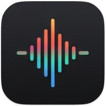
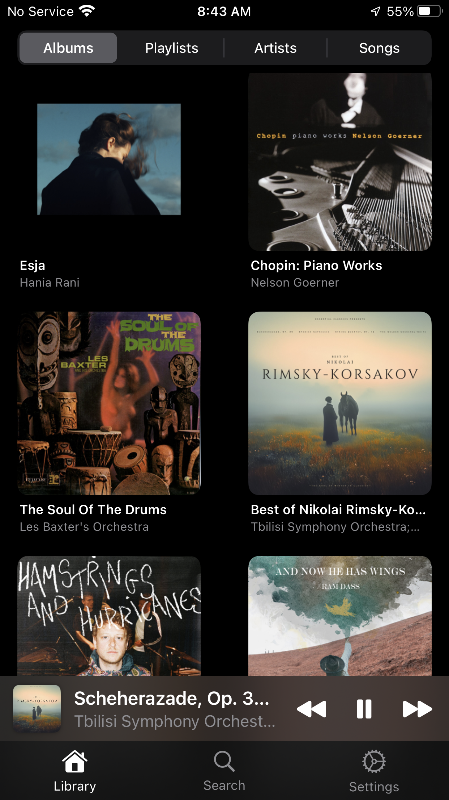
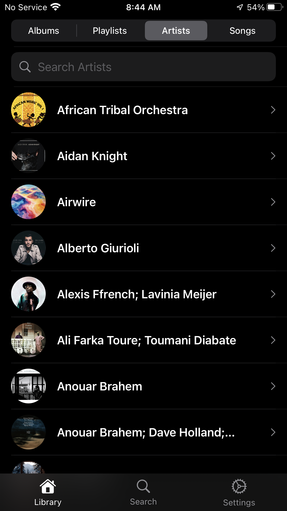
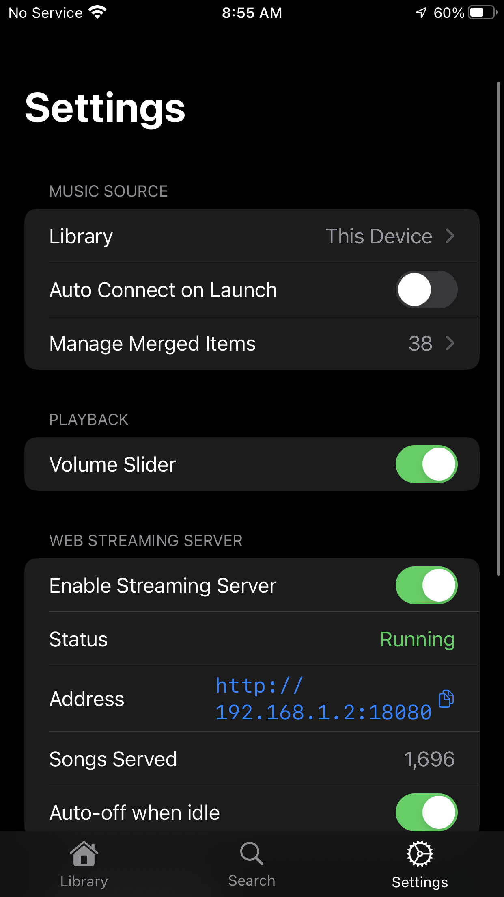
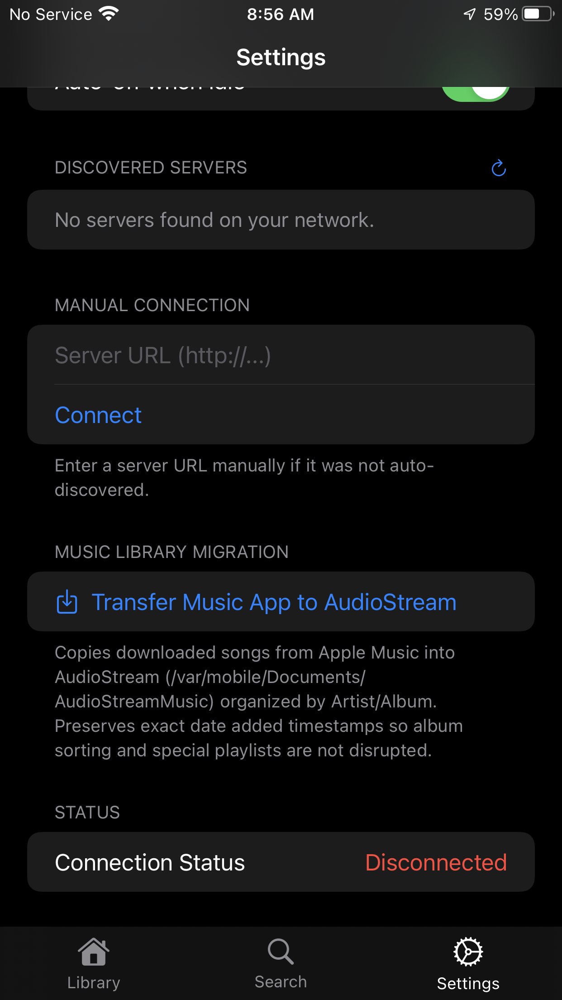
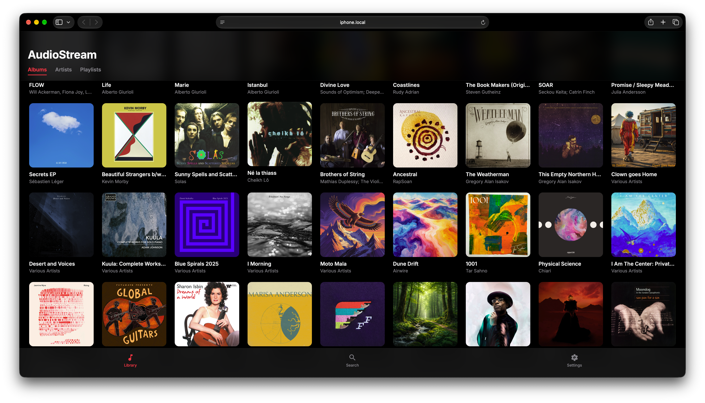

# AudioStream 

AudioStream is a self-hosted music server for jailbroken iOS. It serves your device's native iTunes library over HTTP or locally, letting you stream your own collection to the AudioStream app or any compatible client on your network.

<p align="center">
  <a href="#features">Features</a> •
  <a href="#http-api">HTTP API</a> •
  <a href="#cli-administration">CLI</a> •
  <a href="#apple-watch--remote-controls">Apple Watch</a> •
  <a href="#requirements--setup">Setup</a> •
  <a href="#entitlements">Entitlements</a>
</p>

---

## Screenshots

<p align="center">
  
  
  
  
</p>

---

## Features

- **Local iOS Library Server (`audiostreamerd`)** — Reads the native iTunes database from `/var/mobile/Media/iTunes_Control/iTunes/MediaLibrary.sqlitedb` and serves audio and artwork via a lightweight HTTP API on port `18080`.
- **Hybrid Player Client** — Seamlessly switch between Local media (via Media Player framework) and Remote media (streaming over HTTP from another AudioStream instance). Both modes share the same queue, Now Playing screen, and controls.
- **Album Merging** — Tap "Merge" or long-press any album to enter interactive merge mode directly on the albums grid. Select a primary target, pick additional albums to combine, and merge in one tap. Manage and unmerge groups in Settings.
- **Artist Merging** — Long-press any artist to combine aliases, feature variations, or split names into a single canonical artist. All songs across merged artists are pooled for playback, queueing, and navigation.
- **Album Cover Art Downloader** — Long-press any album cover to download high-resolution artwork directly from Apple Music or MusicBrainz. The file is saved as `cover.jpg` into the album folder on disk, persisting across rescans and the streaming daemon. Includes a manual search modal for fine-grained query adjustments.
- **Smart Playlists** — Automatically generates and keeps current date-based playlists: Recently Added, Month, 3 Months, 6 Months, and Year. Dates pull from filesystem attributes or iTunes properties, with a chronological fallback for remote streaming.
- **Dynamic Artist Profile Images** — Fetches artist profile pictures from Deezer's public API and caches them in memory. Falls back to local album art if offline.
- **Mac Import Tool (`import_from_mac.sh`)** — Imports ZIP packages and folders over SSH. Parses Tidal metadata in FLAC files, downloads missing artwork from Tidal, converts tracks to M4A ALAC, and transfers them to the device.
- **Track Deletion** — Delete songs directly from the track context menu or swipe-to-delete, with automatic disk cleanup and library state sync.
- **Auto-off Idle Protection** — A detached background monitor (`autooff_monitor.sh`) watches HTTP traffic and shuts down the daemon after 10 minutes of inactivity to preserve battery.
- **Apple Watch and Lock Screen Controls** — Full integration with `MPRemoteCommandCenter` and `MPNowPlayingInfoCenter`. Supports shuffle, repeat, scrubbing, and queue position reporting from the system Now Playing interface without requiring a watchOS app.
- **Command Line Administration** — A helper (`audiostream`) installed to `/var/jb/usr/bin/` for starting, stopping, and querying the daemon directly from the terminal.

---

## HTTP API

The streaming daemon (`audiostreamerd`) exposes a lightweight HTTP API on port `18080`.

| Method | Path | Description |
|--------|------|-------------|
| `GET` | `/api/songs` | Returns all songs from the iTunes library and custom folders as a JSON array. |
| `GET` | `/api/playlists` | Returns all native iTunes playlists and autogenerated smart playlists. |
| `GET` | `/music/<filename>` | Streams an audio file. Supports HTTP range requests for efficient scrubbing. |
| `GET` | `/artwork/<persistentId>` | Serves embedded album artwork or falls back to a folder image. |

Example:

```bash
curl http://iphone.local:18080/api/songs > songs.json
```

---

## CLI Administration

Once deployed, the daemon is controlled from the device terminal:

```bash
# Start the streaming server
audiostream start

# Start with battery-saving auto-off (10-min idle timeout)
audiostream start --auto-off

# Stop the streaming server
audiostream stop

# Check whether the server is running
audiostream status
```

---

## Browser

<p align="center">
  
</p>

---

## Apple Watch & Remote Controls

AudioStream maps system Now Playing remote feedback actions to in-app functions, available from the Apple Watch "..." (More) menu and the iOS Lock Screen.

| Watch Menu Label | Action |
|:---|:---|
| Play More Like This | Queue Album — adds remaining tracks from the active album to the queue. |
| Bookmark | Queue Artist — queues and shuffles all songs by the active track's artist. |
| Play Less Like This | Shuffle All — shuffles the entire library and starts playback immediately. |

Standard controls (shuffle, repeat, scrubbing, queue index) are fully supported and sync bidirectionally.

---

## Requirements & Setup

- Xcode 15.0 or later
- iOS 14.6 or later (deployment target)
- [XcodeGen](https://github.com/yonaskolb/XcodeGen)
- Jailbroken iOS device with `appinst`, `sbdidlaunch`, and `sshpass` available

### Install via Sileo / Zebra

Add the RemoteCompanion Repo to your package manager of choice:

- **Repository URL:** `https://saihgupr.github.io/audiostream/`
- **[Add to Sileo](sileo://source/https://saihgupr.github.io/audiostream/)**
- **[Add to Zebra](zbra://sources/add/https://saihgupr.github.io/audiostream/)**

Once added, search for **AudioStream** and tap Install.

### Generate the Xcode project

```bash
xcodegen generate
```

### Build and deploy

The repo includes deployment scripts (not tracked in source control) that automate the archive, IPA packaging, ad-hoc codesign, installation, and daemon deployment over SSH.

```bash
export DEVICE_PASS=yourpassword
./deploy.sh          # Deploy to iPhone
./deploy.sh ipad     # Deploy to iPad (set IPAD_HOST env var)
```

The scripts compile the streaming daemon (`audiostreamerd`) directly using `swiftc`, sign it with the required entitlements via `ldid`, and install the CLI helper to `/var/jb/usr/bin/audiostream`.

---

## Repository Structure

```
App/                  Application entry point, Info.plist, entitlements, assets
Models/               Codable data structures (Track, Album, Playlist, ServerSong)
Services/
  AudioPlayerService        AVPlayer wrapper for local and network streaming
  AlbumMergeService         Album merge group management and application
  ArtistMergeService        Artist merge group management and application
  ArtworkDownloadService    Apple Music and MusicBrainz album art downloader
  LocalFileLibraryScanner   Filesystem crawler, metadata parsing, artwork cache
  MusicLibraryService       iTunes library queries and remote HTTP endpoints
  MusicMigrationService     Library migration and embedded artwork extraction
  MusicServerManager        Daemon toggle and auto-off control
  ServerConnectionService   Network discovery and connection state tracking
  NavigationManager         Tab routing state
Server/
  Daemon/             Daemon entry point and filesystem scanner (main.swift)
  Core/               HTTP server and web UI (MusicServerCore, MusicServerHTML)
UI/
  Components/         MiniPlayer, AlbumCard, CustomTabBar, RemoteImage,
                      PlaylistArtworkView, AlbumMergeSheet, ArtistMergeSheet
  Views/              ContentView, LibraryView, NowPlayingView, SettingsView,
                      SearchView, ArtistDetailView, AlbumDetailView,
                      MergeManagementView
project.yml           XcodeGen project specification
audiostream           CLI helper script for device administration
CHANGELOG.md          Project changelog
README_SETUP.md       Manual setup and configuration reference
```

---

## Entitlements

Reading the system iTunes SQLite database requires specific private entitlements, necessitating jailbroken deployment:

- `com.apple.private.security.no-sandbox = true`
- `kTCCServiceAppleMusic = allowed`
- `com.apple.security.network.server = true`
- `com.apple.security.network.client = true`

---

## Contributing

Issues and pull requests are welcome. Please use the [develop branch](https://github.com/saihgupr/AudioStream/tree/develop) for all contributions. Open an [issue](https://github.com/saihgupr/AudioStream/issues) to discuss significant changes before submitting a PR.

---

## Support

For questions or bug reports, open a [GitHub Issue](https://github.com/saihgupr/AudioStream/issues).

If AudioStream is useful to you, consider supporting via [Ko-fi](https://ko-fi.com/saihgupr).
